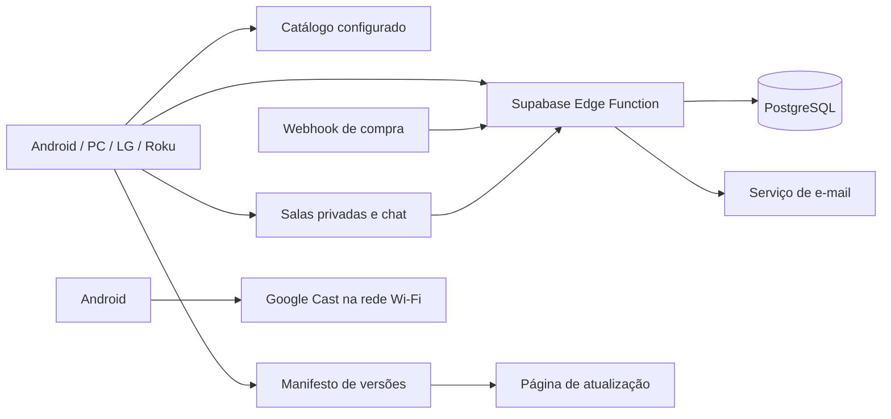

<p align="center"></p>

# CHPlayer

**Estudo prático de desenvolvimento com inteligência artificial, usando um aplicativo de mídia multiplataforma como projeto de aprendizado.**

Sou [João Chiquetto / ChiquettoDev](https://github.com/ChiquettoDev). Precisei de bastante ajuda do **ChatGPT/Codex** para desenvolver o CHPlayer. A maior parte da implementação, das correções, dos testes automatizados e desta documentação foi produzida ou ajustada pelo assistente de IA a partir das minhas solicitações. Meu objetivo principal foi estudar como usar essas ferramentas e treinar minhas habilidades para orientar, testar e melhorar um projeto com elas.

## Minha participação e o papel da IA

| Área | Como aconteceu |
|---|---|
| Objetivos e funcionalidades | Defini o que queria construir, as plataformas e as prioridades, refinando os pedidos durante o projeto. |
| Testes de uso e feedback | Testei versões, enviei capturas e relatei problemas de interface, reprodução, catálogo e descoberta de TVs. Isso não significa que todos os recursos tenham sido validados em todos os aparelhos. |
| Implementação e investigação técnica | O ChatGPT/Codex escreveu e alterou grande parte do código, pesquisou soluções, utilizou ferramentas de análise e executou compilações e verificações. |
| Correções guiadas pelos meus relatos | Pedi ajustes como remover controles duplicados, adequar as atualizações a cada plataforma e corrigir a entrada que confundia Kenan & Kel com outra produção. As respectivas mudanças técnicas foram implementadas com a IA. |
| Edições manuais no código | Também editei partes do código em outro computador. Ainda não tenho um registro consolidado dos arquivos e trechos que alterei, então não atribuo aqui funções específicas à minha edição manual. |
| Documentação e apresentação | Preparadas com o assistente de IA, seguindo meu pedido de explicitar essa participação e as limitações do projeto. |

Este portfólio mostra um processo de aprendizado com IA e o resultado dessa colaboração. **Não representa uma aplicação programada integralmente por mim, nem comprova domínio independente de todas as tecnologias abaixo.** O código serve para estudar as soluções e acompanhar minha evolução.

`React Native` · `Expo` · `Kotlin` · `Google Cast` · `Electron` · `webOS` · `BrightScript` · `Deno` · `PostgreSQL / Supabase`

## O problema

Organizar navegação e reprodução de mídia em diferentes tipos de dispositivo, mantendo preferências, acesso e distribuição coerentes. Um celular precisa de interação por toque e controle Cast; um computador exige janela responsiva e teclado; uma TV precisa de foco e navegação por controle remoto.

## Funcionalidades trabalhadas com a IA

- Catálogo com busca, favoritos, fontes alternativas, filmes e episódios por temporada.
- Reprodução local e recuperação do progresso.
- Google Cast no Android, com descoberta ativa no Wi-Fi e controle de play/pausa, volume, canais e avanço/retrocesso de 20 segundos.
- Salas privadas por convite, chat e sincronização controlada pelo anfitrião.
- Ativação de acesso, processamento de pedidos e entrega por e-mail no servidor.
- Página de atualização com arquivo, versão e instruções específicos de cada plataforma.
- Correções e testes de leitores de catálogo para caminhos, parâmetros de URL e identificação de títulos.

## Plataformas e versões do produto documentadas

| Plataforma | Tecnologia | Versão documentada |
|---|---|---|
| Android | React Native / Expo + Kotlin | 0.3.8 |
| Windows / Linux | Electron | 0.5.5 |
| LG TV | Aplicativo webOS | 0.4.5 |
| Roku | SceneGraph / BrightScript | 0.4.4 |

Esses números descrevem os pacotes do produto. Este repositório contém amostras revisadas para portfólio, não os instaladores completos nem um catálogo público de conteúdo.

## Arquitetura



[Arquitetura e fluxo dos módulos](docs/architecture.md) · [Decisões e desafios](docs/engineering.md) · [Validação e limites](docs/validation.md)

## Código para explorar

| Área | Onde começar |
|---|---|
| Interface Android | [App.js](src/android/App.js) |
| Descoberta de TVs | [CastDiscovery.js](src/android/CastDiscovery.js) e [ponte Kotlin](src/android/native/CastDiscoveryPackage.kt) |
| Reprodução remota | [TVPlayback.js](src/android/TVPlayback.js) |
| Leitura de catálogos | [playlist.cjs](src/android/playlist.cjs) e [saimo.cjs](src/android/saimo.cjs) |
| Salas e chat | [Rooms.js](src/android/Rooms.js) |
| Electron / IPC | [main.cjs](src/desktop/main.cjs) e [preload.cjs](src/desktop/preload.cjs) |
| Servidor e dados | [index.mjs](src/server/index.mjs) e [migrações](src/server/migrations) |
| Atualização por dispositivo | [lógica da página](src/site/updates-page.js) e [Roku](src/roku/UpdateController.brs) |

## Executar os testes

Requer Node.js 22 ou superior. Os testes usam o executor nativo do Node e não precisam de instalar dependências:

```bash
git clone https://github.com/ChiquettoDev/chplayer.git
cd chplayer
npm test
npm run check:server
```

São **13 testes automatizados** de parsers e conversão de mídia Cast. Eles usam dados sintéticos e não acessam catálogos, contas ou dispositivos reais. A integração contínua executa os mesmos comandos.

## O que estou aprendendo

Meu foco foi transformar ideias em pedidos mais claros para a IA, dividir o trabalho em etapas, testar o resultado e descrever os problemas para orientar novas tentativas. Também estou estudando o código gerado e os conceitos de parsers, reprodução, rede, persistência, servidor e distribuição por plataforma.

As explicações de arquitetura e decisões técnicas registram soluções produzidas durante esse processo com o assistente. São material de estudo; não uma afirmação de que eu já conseguiria implementar sozinho todos esses componentes.

## Escopo, autoria e referências

A base de referência Saimo foi estudada com a ferramenta [REA](https://github.com/morluto/rea). Este repositório não apresenta bundles de referência ou bibliotecas de terceiros como autoria própria. Os módulos selecionados mostram adaptações e integrações do projeto CHPlayer. Os nomes de formatos e testes de regressão foram preservados para documentar problemas reais de compatibilidade.

Não há fontes de vídeo, filmes, episódios, chaves de acesso ou credenciais de produção nesta publicação. Links a serviços oficiais não representam extração ou retransmissão de seus catálogos. Consulte [o escopo da amostra](src/README.md) e [os avisos de autoria](NOTICE.md).
